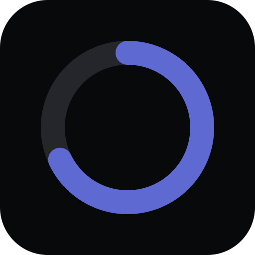

<div align="center">



# Spese

### How much can I still spend this pay cycle?

**A salary-first expense tracker that answers the only money question that matters — in one glance, in under five seconds, without your data ever leaving your phone.**

[**Open the app →**](https://spese-lake.vercel.app) &nbsp;·&nbsp; [Install on iPhone](#-install-it-in-30-seconds) &nbsp;·&nbsp; [Features](#-what-it-does) &nbsp;·&nbsp; [Privacy](#-private-by-design) &nbsp;·&nbsp; [Run it yourself](#-run-it-yourself)


</div>

---

## 💸 The problem

Your bank app shows you transactions. Spreadsheets need discipline you don't have at 11 pm. Most expense trackers start from what you *spent* — and still leave you guessing what you can *afford*.

**Spese starts from your salary.** Tell it what lands in your account and when. Rent, WiFi and the gym deduct themselves on their due day. Every coffee you log comes off the top. What's left is always one number, right at the top of the screen:

> **₹24,350 remaining** · 49% of ₹50,000 left · 18 days to go · **₹1,120 safe to spend today**

That's the whole idea. Everything else explains how you got there.

---

## ✨ What it does

### The essentials — built for the moment you pay

- **Log an expense in under 5 seconds.** Tap **+**, type the amount, press Enter. Your last category and payment method are already picked.
- **Pay cycles that match real life.** Paid on the 25th? Your month runs 25th → 24th. Paid on the 31st? Short months just work. Salary came early or late? Shift the cycle in one tap.
- **Fixed costs that deduct themselves.** Add rent once and it's taken on its day, every cycle — even while the app is closed. Pause the gym for a month, skip one cycle, or end it; history stays intact.
- **Refunds that make sense.** Paid ₹1,800 for dinner and a friend sent back ₹600? Attach it to the expense — it now counts as ₹1,200 everywhere, without cluttering your list.
- **Bonuses and side income.** One-off income or a recurring monthly bonus that adds itself — never counted until it actually arrives.

### A dashboard that explains itself

- **Balance card** — what's left, % of income, days left, and what's still committed to fixed costs.
- **Safe to spend today** — your free money spread over the days left (and your savings goal set aside first).
- **Next 7 days** — the rent and subscriptions about to hit.
- **Spend by category**, **daily trend vs an even pace**, **month over month**, and your **savings rate** across cycles.
- **Budgets per category** with a heads-up at 80% and an alert when you go over — the moment you log the expense that crosses the line.

### Find anything, take it anywhere

- **Search** notes, categories, amounts ("₹1,800" or "1800"), even the note on a refund. Filter by category, payment method (UPI · Card · Cash) and dates.
- **Export** everything to CSV for your spreadsheet, or print a clean **one-cycle PDF report**.
- **Back up and restore** with a single file — on a new phone, you're back in seconds.

### Yours, and only yours

- **App lock** with a PIN or **Face ID / fingerprint**. Locks when you leave for more than a minute — so hopping to your UPI app and back doesn't nag you.
- **Hidden in the app switcher**, so your balance never shows up on a shared screen.
- **Daily reminders** (optional) — "Rent ₹15,000 deducted today" or a nudge to log what you spent. Written *on your phone*, from your own data.

---

## 🔒 Private by design

Spese isn't private because of a policy. It's private because of how it's built.

| | |
|---|---|
| **No account** | No sign-up, no email, no password to leak. |
| **No server holding your money** | Every rupee lives in your phone's own storage (IndexedDB). There is no database in the cloud to breach. |
| **No tracking** | No analytics, no ads, no third-party scripts watching you. |
| **Reminders without exposure** | The optional push server knows only *when* to knock — your phone's push address, a time and a timezone. It sends an empty push; your phone writes the message. With the app lock on, notifications show no numbers at all. |
| **Your data, portable** | One-tap backup file and CSV export. Leave any time, take everything with you. |

---

## ⚡ Fast, offline, and careful with money

- **Opens in ~200 ms** and saves an expense in under 50 ms (measured on a production build, desktop; phones are a few times slower and still well under the 2-second target).
- **Works fully offline** — it's an installable PWA with everything cached on first visit.
- **Money is stored as integer paise**, never floating-point rupees, so ₹0.10 + ₹0.20 is always exactly ₹0.30.
- **Accessible**: WCAG AA contrast (checked with axe), screen-reader labels, large-text support, and a full keyboard map on desktop (`N` new expense, `/` search, `Esc` close).
- **Colour-blind-safe charts**: the category palette is validated for deuteranopia, protanopia and tritanopia — and every chart also labels by name, never colour alone.

---

## 📱 Install it in 30 seconds

No App Store. No Play Store. Just the web, installed like an app.

**iPhone (iOS 16.4+)**
1. Open **[spese-lake.vercel.app](https://spese-lake.vercel.app)** in **Safari**.
2. Tap **Share** → **Add to Home Screen**.
3. Open Spese from your Home Screen, enter your salary and pay day — done.

**Android (Chrome)**
1. Open the link in Chrome → **Install app** (or Settings → Install inside Spese).

> 💡 Already using it in a browser tab? Export a backup there and restore it in the installed app — a home-screen app has its own storage.

---

## 🧱 Built with

| | |
|---|---|
| **UI** | React 19 · TypeScript (strict) · Tailwind CSS 4 |
| **Data** | Dexie on IndexedDB — local-first, live queries |
| **Charts** | Recharts, lazy-loaded so the balance appears first |
| **Offline & install** | vite-plugin-pwa with a custom Workbox service worker |
| **Reminders** | A tiny Cloudflare Worker + Web Push (VAPID), payload-free |
| **Quality** | Vitest + Testing Library — **225 tests**, from month-end edge cases to the lock screen |

**Design:** dark, quiet and dense — thin 1px borders, one accent colour, numbers as the hero, and motion only where it helps.

---

## 🛠 Run it yourself

```bash
git clone https://github.com/shadow-here/spese.git
cd spese
npm install
npm run dev        # http://localhost:5173
```

| Command | What it does |
|---|---|
| `npm run dev` | Start the dev server |
| `npm test` | Run the full test suite |
| `npm run typecheck` | Type-check the app, service worker and push server |
| `npm run build` | Production build into `dist/` |
| `npm run preview` | Serve the production build (offline-capable) |

**Deploying:** it's a static site — Vercel and Netlify configs are included. See [`docs/DEPLOY.md`](docs/DEPLOY.md).
**Reminders:** optional; set up the push server with [`docs/PUSH.md`](docs/PUSH.md).

<details>
<summary><b>Project structure</b></summary>

```
src/
  domain/     pure money logic — pay cycles, balance, refunds, budgets, history (fully unit-tested)
  db/         Dexie database and everything that changes data
  features/   UI pieces: expense sheet, fixed costs, dashboard cards, lock, reminders…
  pages/      Dashboard, Transactions, Fixed, Settings, Report, Onboarding
  push/       writes the reminder text on the phone
  sw.ts       service worker: offline cache, updates, reminder pushes
push-worker/  the optional Cloudflare Worker that schedules reminders
docs/         product spec, roadmap, deploy and push-server guides
```

</details>

---

## 🗺 Roadmap

- [x] **v1.0** — salary & pay cycles, quick-add expenses, fixed auto-deductions, dashboard, backup, offline PWA
- [x] **v1.1** — welcome & restore, extra income & monthly bonus, refunds, custom categories, safe-to-spend, month-over-month, savings rate, budgets & alerts, savings goal, payment methods, search & filters, CSV & PDF export, app lock, daily reminders
- [ ] **v2** — optional cloud sync, bank-statement import, plain-language insights ("Food is up 22% vs last month"), yearly view, splitting with friends

Full details in [`docs/ROADMAP.md`](docs/ROADMAP.md) and the product spec in [`PRD.md`](PRD.md).

---

<div align="center">

**Know what's left. Spend without the guilt.**

[**Start using Spese →**](https://spese-lake.vercel.app)

</div>
